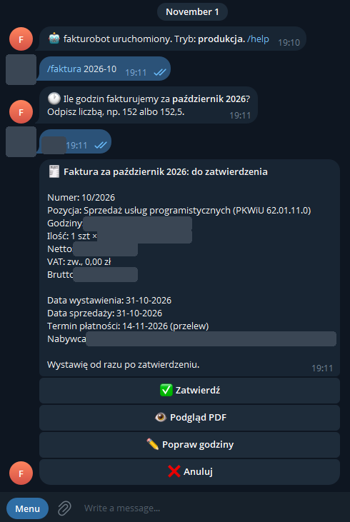
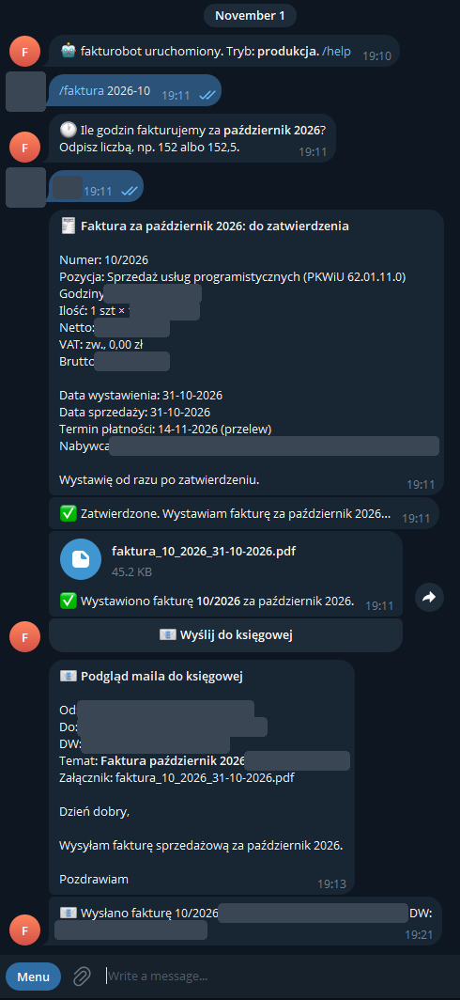

# fakturobot

Bot na Telegramie, który raz w miesiącu wystawia fakturę za godziny pracy i wysyła ją księgowej.

<p>
  
  
</p>

## Jak to działa

1. Pod koniec miesiąca bot pyta: „Ile godzin fakturujemy za październik 2026?”
2. Odpowiadasz liczbą (np. `152` albo `152,5`). Bot liczy kwotę (godziny × stawka) i pokazuje podsumowanie z numerem faktury, datami i nabywcą. Do wyboru: **Zatwierdź**, **Podgląd PDF**, **Popraw godziny** albo **Anuluj**.
3. Ostatniego dnia miesiąca bot nadaje kolejny numer (np. `10/2026`), generuje PDF, archiwizuje go i przysyła na Telegram. Kopia idzie na Twojego Gmaila.
4. **Wyślij do księgowej** pokazuje podgląd maila (adresaci, temat, treść, załącznik). Mail wychodzi z Twojego Gmaila dopiero po kliknięciu **Wyślij teraz**.

Komendy:

| | |
|---|---|
| `/faktura [RRRR-MM]` | zacznij teraz (bieżący albo zaległy miesiąc) |
| `/faktury` | ostatnie faktury z możliwością pobrania PDF |
| `/eksport [RRRR]` | zestawienie faktur z roku w CSV |
| `/status` | tryb pracy i następny numer |
| `/testmail` | testowy mail przez Gmail API |

Harmonogram (Europe/Warsaw):
- bot pyta 3, 2 i 1 dzień przed końcem miesiąca o 10:00;
- ostatniego dnia o 10:00 wystawia zatwierdzoną fakturę, a o 18:00 przypomina, jeśli nie ma godzin;
- o zaległej fakturze przypomina do 15. dnia następnego miesiąca.

Daty: wystawienie i sprzedaż to ostatni dzień fakturowanego miesiąca, a termin płatności to +14 dni (do ustawienia w configu).

Bot reaguje tylko na Twój `chat_id`, działa przez long polling (bez otwartych portów), a ponowne kliknięcie przycisku nie wystawi ani nie wyśle niczego drugi raz.

## Konfiguracja

- **`config.yaml`** ([przykład](config.example.yaml)): stawka, numeracja, harmonogram, treść maila i stałe dane faktury (sprzedawca, nabywca, pozycja, konto, uwagi).
- **`.env`** ([przykład](.env.example)): token bota, `chat_id`, dane OAuth Gmaila, adres księgowej i kopie (DW). `DRY_RUN=true` daje testowe faktury bez wysyłania maili.

Prawdziwe pliki leżą tylko na serwerze (`/etc/fakturobot/`), a archiwum faktur w `/var/lib/fakturobot/`.

### Telegram

1. Utwórz bota: w [@BotFather](https://t.me/BotFather) wyślij `/newbot`, a token wpisz do `TELEGRAM_BOT_TOKEN`.
2. Swoje `Id` sprawdzisz u [@userinfobot](https://t.me/userinfobot). Wpisz je do `TELEGRAM_CHAT_ID`.
3. Napisz `/start` do swojego bota.

### Gmail API (tylko uprawnienie `gmail.send`)

1. W [Google Cloud Console](https://console.cloud.google.com/) utwórz projekt i włącz **Gmail API**.
2. W *Platformie uwierzytelniania Google* (ekran zgody OAuth):
   - typ **Zewnętrzni**;
   - w *Dostępie do danych* dodaj zakres `gmail.send`;
   - w *Odbiorcach* kliknij **Opublikuj aplikację**. W trybie testowym token wygasa po 7 dniach.
3. W *Klientach* utwórz klienta typu **Aplikacja komputerowa** i pobierz JSON.
4. Na swoim komputerze uruchom (wystarczy sam Python):
   ```
   python -m fakturobot.gmail_auth client_secret.json
   ```
   Zaloguj się i zezwól na wysyłanie. Ostrzeżenie o niezweryfikowanej aplikacji jest normalne. Skrypt wypisze `GOOGLE_CLIENT_ID`, `GOOGLE_CLIENT_SECRET` i `GOOGLE_REFRESH_TOKEN` do wpisania w `.env`.
5. Sprawdź wysyłkę komendą `/testmail`.

## Wdrożenie

Serwer z Ubuntu 24.04, `python3.12-venv` i `fonts-dejavu-core`:

```bash
git archive --format=tar.gz -o fakturobot.tar.gz HEAD
scp fakturobot.tar.gz serwer:/tmp/
ssh serwer 'mkdir -p /tmp/fb && tar -xzf /tmp/fakturobot.tar.gz -C /tmp/fb && sudo bash /tmp/fb/deploy/install.sh'
```

`install.sh` tworzy użytkownika systemowego, virtualenv i usługę systemd z hardeningiem. Nie nadpisuje istniejących `.env`, `config.yaml` ani bazy. Potem:

```bash
sudoedit /etc/fakturobot/.env            # zacznij od DRY_RUN=true
sudoedit /etc/fakturobot/config.yaml
sudo systemctl restart fakturobot
journalctl -u fakturobot -f              # logi
```

Gdy test w DRY_RUN przejdzie, ustaw `DRY_RUN=false` i zrestartuj usługę. Baza testowa i produkcyjna są osobne.

## Rozwój

```bash
python3.12 -m venv .venv && . .venv/bin/activate
pip install --require-hashes -r requirements.txt -r requirements-dev.txt
pytest
pre-commit install   # gitleaks przed każdym commitem
```

Zależności są przypięte z hashami. Lock generuje `uv pip compile` (polecenie w nagłówku [`requirements.in`](requirements.in)).

## Licencja

MIT
